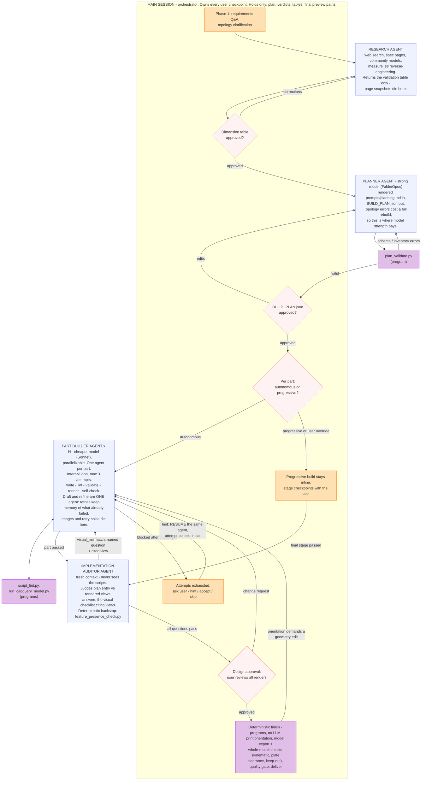

# Sub-agent pipeline architecture

Target architecture for splitting the cq-design pipeline into sub-agents.
Purpose: clean state per role, less main-session context pressure, per-role
model routing (strong model for planning, cheaper model for part authoring).

Two forces determine every agent boundary:

1. **User interaction** - sub-agents cannot talk to the user. Every checkpoint
   (dimension table, plan approval, design approval, progressive-build stages,
   hint requests) MUST live in the main session.
2. **Context weight** - web page snapshots and preview PNGs are the heavy
   payloads. They belong inside the agent that consumes them, so they never
   accumulate in the main session.



Legend: indigo = LLM sub-agent, purple = deterministic program, red diamond =
gate, orange = main-session user interaction.

## Agent roster

| Agent | Model | Input | Output | Why it is an agent |
|---|---|---|---|---|
| Research | default | product names, lookup targets | dimension validation table + sources, `parameters.py` values | page snapshots are huge; main gets a table |
| Planner | strong (Fable/Opus) | rendered `prompts/planning.md` | `BUILD_PLAN.json` | topology reasoning is the highest-leverage LLM step; a wrong topology is a full rebuild |
| Part builder (x N) | cheaper (Sonnet) | rendered `prompts/part.md` (already self-contained by design) | passing `build/<id>.py`, bbox, preview paths, `attempts.jsonl` rows | contains the render images and retry noise; clean state between parts |
| Implementation auditor | default (vision) | plan part entries + preview/section PNGs, NOT the scripts | per-question pass/fail with cited views | kills self-review bias - the author never grades its own homework |

## Design rules

- **Draft and refine are one agent.** A separate refiner re-pays the whole
  reference-token cost each round while losing the one thing that makes retries
  cheap: memory of what attempt N already tried. The 3-attempt loop with typed
  error hints stays inside a single builder agent.
- **Two audits, two owners.** "3D-printing failure points" is deterministic
  (`script_lint.py`, `run_cadquery_model.py`, `quality_gate.py`) - programs,
  never agents. "Is the plan implemented" is the fresh-context LLM audit - the
  single strongest quality argument for the split.
- **Escalation resumes, never respawns.** A builder that exhausts its attempts
  returns `blocked` + error summary; main asks the user; the SAME agent is
  resumed with the hint, so attempt context is preserved exactly when it is
  valuable.
- **Progressive parts stay conversational.** The existing complexity gate
  (interfaces present, or >= 3 blocks) becomes an agent-routing gate:
  autonomous parts go to builder agents, progressive parts run inline in main
  because each stage needs a user checkpoint.
- **Orientation is not terminal.** The print-orientation loop can demand
  geometry edits (chamfer an overhang, add a foot); that re-enters the builder
  and re-runs validation + audit for the touched part.
- **No `.claude/agents/` files needed.** The part prompt is already a fully
  rendered, self-contained text artifact; main passes it as an Agent-tool
  prompt with a per-call model override. Portable with the skill.

## Known tensions (measured, not assumed)

- **Cold-start cost vs. context relief.** Each builder re-reads the CadQuery
  Pattern Reference + Anti-Patterns + FDM guidelines. Inline pays that once;
  agents pay it N times - but inline pays image accumulation, which grows
  superlinearly with part count. `evals/run_evals.py` (cost per accepted part,
  first-shot rate, attempts-to-pass) is the acceptance test. No adoption on
  vibes.
- **Cross-part carryover is lost.** Inline, fixing `workplane_drift` on part 1
  makes part 3's author smarter. Mitigation: mine this session's
  `build/attempts.jsonl` error patterns into a one-line "known pitfalls" note
  injected into subsequent builder prompts.
- **Interface consistency across parts.** Two isolated builders authoring a
  mating pair can drift where one inline author would not. The plan's
  `interfaces` entries are the contract; kinematic, plate-clearance, and
  feature-presence checks are the deterministic net. Watch this in the first
  eval runs.
- **Parallel builders** need collision-free telemetry appends and per-part
  preview paths (mostly already true; verify before enabling parallelism).

## Sequencing

`split-skill-md` (progressive doc loading) lands first: its per-phase files are
exactly the per-agent instruction sources this architecture needs, and in the
agent world the main session never loads Phase 3 detail at all -
`skill/phase3_build.md` effectively becomes the builder agent's prompt.

Model routing finally gives the telemetry `model` field (currently hardcoded
`"inline"`) real values, so the eval harness can prove whether the routing pays
for itself.
    A["`**Plan:** <br> LLM describes the mechanical strategy`"] --> B["`**Draft:** <br>LLM writes the CadQuery code.`"]
    B -- generated code --> C["`**Audit:** <br>Programm eviews for 3D printing failure points`"]
    C -- identifies quality issues --> E{"`**Verification**<br>Clean?`"}
    D["`**Refine:** <br>LLM applies the fixes`"] -- refined code --> C
    E -- "No - issues found" --> D
    E -- "Yes - clean" --> K["`**Audit**<br>LLM audits if the plan is implemented`"]
    K --> H{"`Implementation<br> according to <br>**Plan**?`"}
    H -- "No - deviates from plan" --> D
    H -- Plan implemented --> I["Customer Review"]
    F["Programm optimizes print orientation"] --> G["✓ Final Code"]
    I --> J{"Approved"}
    J -- Yes --> F
    J -- No --> D


    style A stroke:#818cf8,fill:#eef2ff
    style B stroke:#818cf8,fill:#eef2ff
    style C stroke:#AA00FF,fill:#E1BEE7
    style E stroke:#f87171,fill:#fef2f2
    style D stroke:#818cf8,fill:#eef2ff
    style K stroke:#818cf8,fill:#eef2ff
    style H stroke:#f87171,fill:#fef2f2
    style I fill:#FFE0B2,stroke:#FF6D00
    style F stroke:#AA00FF,fill:#E1BEE7
    style G stroke:#4ade80,fill:#f0fdf4
    style J stroke:#f87171,fill:#fef2f2
```
# Plan 
- Interview user intent
- Web search
- measure dimensions in .stl, .step ...

# Agents
- Plan
- Draft
- Audit
- Refine
