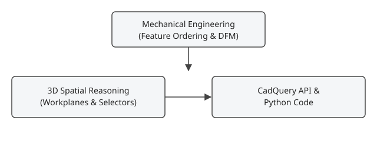
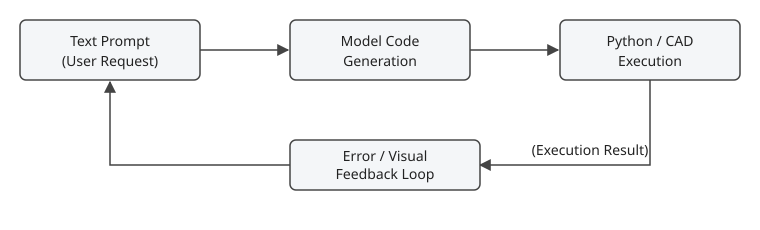

# Knowledge Domains

For a frontier LLM to excel at **Text-to-CAD using CadQuery**, it needs more than just Python proficiency. Generating functional, valid 3D models require a synthesis of software engineering, spatial reasoning, mechanical design principles, and CadQuery’s specific paradigm.

The essential knowledge domains break down across **Core Domains**, **Domain Intersections**, and the **Architectural Loop** needed to tie them together.

---

## 1. Core Knowledge Domains

### 📐 3D Geometry & Computational Spatial Reasoning

The model must maintain an accurate internal 3D spatial map from text descriptions alone.

* **3D Transformations:** Vector math, translation, rotation matrices, quaternions, and coordinate system mappings (Local vs. Global workplanes).
* **Boundary Representation (B-Rep):** Understanding how 3D solids are defined by vertices, edges, wires, faces, and shells (the underlying geometry paradigm of OpenCASCADE).
* **Constructive Solid Geometry (CSG):** Boolean operations—union (`union`), difference (`cut`), and intersection (`intersect`).

### 🐍 Advanced Python & Fluent CadQuery API

Since CadQuery is a Python library built on top of OpenCASCADE, deep Python fluency is mandatory.

* **Fluent Interface Paradigm:** CadQuery relies heavily on method chaining (e.g., `cq.Workplane("XY").box(10, 10, 10).faces(">Z").hole(5)`). The model must track object state transitions across long chains.
* **CadQuery Selector Syntax:** String-based string expressions used to query faces, edges, and vertices (e.g., `>Z` for top face, `|X` for edges parallel to X-axis, `%Circle` for circular edges).
* **Parametric Scripting:** Using dynamic variables, functions, and loops to build modular, re-configurable CAD code instead of hardcoded magic numbers.

### ⚙️ Mechanical Engineering & CAD Conventions

Generating physically sound and manufacturable geometry requires understanding real-world CAD workflows.

* **Feature-Based Modeling:** Sketching on a 2D plane → Extruding/Revolving/Lofting → Applying local features (fillets, chamfers, shells, countersunk holes).
* **Design for Manufacturability (DFM):** Draft angles for injection molding, clearance/tolerances for assemblies, and stress relief radii.
* **Dimensioning & Constraints:** Spatial relationships between features (e.g., "a hole centered 15mm from the left edge and 20mm from the top").

### 🗣️ Domain-Specific NLP (Technical Description Translation)

The model must decode ambiguous human language into explicit geometry.

* **Geometric Intent Disambiguation:** Translating colloquial text like "a bracket with mounting holes on the sides" into exact offsets, hole diameters, and workplane switches.
* **Hierarchical Decomposition:** Breaking a top-level prompt down into sequential modeling steps (Base → Cutouts → Details).

---

## 2. Domain Mapping: How They Intersect

Success requires seamless integration across these fields:



| Domain Pair | Key Skills Learned at the Intersection |
| --- | --- |
| **Spatial Reasoning + CadQuery** | Knowing which CadQuery selector string (`>Z`, `<Y`, ## & (OpenCASCADE (Post-Processing (e.g., **Code **Geometric **Mechanical **Python **Visual/Spatial *last* + --- 1. 2. 3. 3D <ElicitationsGroup A Applying CadQuery CadQuery** Catching Constructing Design Even Execution Feedback:** LLM Loop Passing Python Reasoning** Running Runtime:** STL/STEP Spatial The Tool Use) Validation:** `cadquery` ` |


---

## 3. The Execution & Feedback Loop (Where Models Win or Lose)

Even with strong pre-training across geometry and Python, a text-to-CAD model cannot reliably generate error-free 3D models in a single pass without an **execution feedback loop**.

The CAD generation process needs to operate as an iterative cycle:



The model must master three runtime feedback capabilities:

### 1. Exception Handling & Stack Trace Analysis

CadQuery wraps OpenCASCADE's C++ core, meaning errors often manifest as complex kernel exceptions rather than standard Python tracebacks.

* **Kernel Exception Mapping:** Diagnosing OpenCASCADE errors like `Standard_ConstructionError` or `BRep_API: command not done` (which often mean self-intersecting wireframes or invalid boolean cuts).
* **Selector Debugging:** Recognizing when a selector string like `.faces(">Z")` returns an empty string list, causing subsequent chained methods to throw non-obvious `IndexError`s.

### 2. Topological & Geometric Validation

Valid Python code can still yield invalid 3D solids. The system must programmatically validate the resulting shape using CadQuery's inspection API (`cq.Workplane.val()`).

* **Non-Manifold Geometry Checks:** Identifying zero-thickness walls, disconnected solids, or self-intersecting surfaces.
* **Feature Constraint Verification:** Verifying bounding box dimensions, volume limits, and face counts against the original prompt requirements.

### 3. Visual Verification (Multimodal Feedback)

Frontier models that accept visual inputs benefit immensely from rendering generated CAD objects into 2D snapshots from standardized orthogonal and isometric views (top, front, side, isometric).

* **Visual Hallucination Detection:** Checking if a feature (e.g., a chamfer or a through-hole) was omitted despite the code executing without errors.
* **Proportional Assessment:** Catching instances where mathematical dimensions are off-scale visually (e.g., a pin that is too short for its corresponding hole).

---

## 4. Key Performance Bottlenecks for Current LLMs

If you are training or benchmarking an LLM for CadQuery generation, these are the common failure modes to design against:

| Failure Mode | Root Cause | Remediation / Training Need |
| --- | --- | --- |
| **Workplane Confusion** | The model loses track of which local coordinate system is active after multiple `.workplane()` switches. | Fine-tuning on step-by-step state tracking annotations. |
| **Selector Halucinations** | Using non-existent selector syntax or applying face selectors to edge-only contexts. | Retrieval-Augmented Generation (RAG) over CadQuery documentation/API reference. |
| **Fillet & Chamfer Crashes** | Applying a fillet radius larger than the adjacent edge length, causing OpenCASCADE kernel failure. | Teaching the LLM to inspect bounding edge lengths before picking fillet sizes. |
| **Missing Boolean Order** | Performing a cut before a union, leaving floating artifacts in 3D space. | Structuring prompt parsing into explicit CSG order steps. |

To invoke these domains and technical capabilities inside your LLM skill (e.g., an AI agent tool, custom system prompt, or API workflow), you need to translate each domain into **concrete software components, prompt structures, and API tools**.

Here is how you structure and invoke them in a production Text-to-CadQuery skill:

---

## 1. System Prompt & Context Injection (The Knowledge Core)

You invoke the **CAD domain knowledge**, **CadQuery API constraints**, and **spatial rules** by injecting explicit design instructions and API cheatsheets into the model's system prompt before generation.

### Example System Prompt Architecture

```markdown
You are an expert CadQuery 3D modeling assistant.

### 1. Spatial & Workplane Rules
- Always declare base workplane explicitly (e.g., `result = cq.Workplane("XY")`).
- Keep track of active coordinate systems when calling `.workplane()`.

### 2. CadQuery API Rules & Selectors
- Face Selectors: `>Z` (top), `<Z` (bottom), `>X` (right), `<X` (left), `>Y` (back), `<Y` (front).
- Edge Selectors: `|Z` (parallel to Z), `#Z` (perpendicular to Z), `%Circle` (circular edges).
- Fillet/Chamfer Safety: Never apply a fillet radius >= shortest adjacent edge length.

### 3. Execution Strategy
1. Analyze primary shape dimensions.
2. Define base 2D sketch and extrude.
3. Select target faces using string selectors to apply features (holes, cuts, fillets).
4. Output ONLY executable Python code returning a variable named `result`.

```

---

## 2. Programmatic Execution & Validation (The Feedback Loop)

To handle **OpenCASCADE exception handling** and **geometry validation**, wrap your LLM invocation inside a Python tool or sandbox environment.

```python
import cadquery as cq

def execute_cadquery_code(code_str: str) -> dict:
    """Executes generated CadQuery code and validates spatial/geometric sanity."""
    local_scope = {"cq": cq}
    
    try:
        # 1. Python Syntax & Execution
        exec(code_str, local_scope)
        
        if "result" not in local_scope:
            return {"success": False, "error": "Code must define a 'result' CadQuery object."}
            
        result = local_scope["result"]
        
        # 2. Geometric Sanity Checks
        val = result.val()
        if val is None or val.ShapeType() != "Solid":
            return {"success": False, "error": "Result is not a valid 3D Solid."}
            
        bounding_box = result.val().BoundingBox()
        
        return {
            "success": True,
            "object": result,
            "dimensions": {
                "xlen": bounding_box.xlen,
                "ylen": bounding_box.ylen,
                "zlen": bounding_box.zlen,
            }
        }

    except Exception as e:
        # Catch OpenCASCADE kernel & Python runtime errors
        return {"success": False, "error": f"{type(e).__name__}: {str(e)}"}

```

---

## 3. Self-Correction Loop (Invoking LLM Re-prompting)

When `execute_cadquery_code` returns `success: False`, feed the error stack trace back into the LLM along with the original code so it can auto-correct itself.

```python
def generate_cad_with_retry(user_prompt: str, max_retries: int = 3):
    code = llm_generate_code(user_prompt)
    
    for attempt in range(max_retries):
        execution = execute_cadquery_code(code)
        
        if execution["success"]:
            return execution["object"]
            
        # Error feedback invocation
        correction_prompt = f"""
The CadQuery code you generated failed with the following error:
{execution['error']}

Original Prompt: {user_prompt}
Failed Code:
```python
{code}

```

Please fix the error (e.g., invalid selector, fillet radius too large, missing workplane) and regenerate the code.
"""
code = llm_generate_code(correction_prompt)

```
raise RuntimeError("Failed to generate valid CAD code within max retries.")

```

```

---

## 4. Visual Verification (Multimodal Invocation)

If using a multimodal model (e.g., GPT-4o, Claude 3.5 Sonnet):

1. Export the validated CadQuery solid to an **STL or STEP file** using `cq.exporters.export()`.
2. Render 2-4 orthographic images (Top, Front, Isometric) using `pythreejs` or VTK/FreeCAD offscreen rendering.
3. Pass the rendered images back into the LLM asking: *"Does this rendered object match the features requested in '{user_prompt}'?"*

<ElicitationsGroup message="Where would you like to dive deeper?">

{/* Reason: Giving logical next steps for implementing this within code or agent framework architectures. */}

  <Elicitation label="Get a complete runnable Python CadQuery agent script" query="Write a full Python script implementing an LLM CadQuery generation loop with execution and error correction."/>
  <Elicitation label="Explore rendering offscreen images for visual feedback" query="How do I render offscreen 2D images of a CadQuery object in Python to pass back to a vision LLM?"/>
</ElicitationsGroup>

```